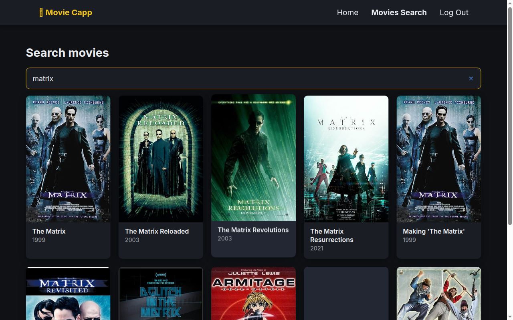

<p align="center">
  
</p>


# Movie Capp

[Live preview](https://tetrameister.github.io/movie-capp/)

Movie Capp is a training project built to practice searching for and displaying movie information. It's a React-based single-page application focused on hands-on practice with routing, component structure, and testing.

**Main features**:
- Simple login (your name is kept in `localStorage`)
- Debounced search for movies by title, with results shown as poster cards
- Movie details: plot, runtime, genre, director, cast and IMDb rating
- Client-side routing between views, including a 404 page
- Responsive layout with a burger menu on mobile

&nbsp;

## 💡 Technologies


&nbsp;

## 💿 Installation

The project uses Node and npm. Having them installed, type into the terminal:

```
npm i
```

The app uses the [OMDb API](https://www.omdbapi.com/). Get a free API key, then copy `.env.example` to `.env` and paste your key:

```
REACT_APP_API_KEY=your_omdb_api_key
```

Then start the development server:

```
npm start
```

The app will run at `http://localhost:3000/movie-capp`.

Other scripts:

```
npm test     # run tests
npm run lint # run ESLint
npm run build
```

### Deployment

Every push to `main` is tested, built and deployed to GitHub Pages by the [CI & Deploy workflow](.github/workflows/deploy.yml). It requires:
- the `OMDB_API_KEY` repository secret (Settings → Secrets and variables → Actions),
- Pages source set to **GitHub Actions** (Settings → Pages).

&nbsp;

## 🤔 Solutions provided in the project

- **Nested routes and URL as state** – the search phrase lives in the URL (`/movies/search/:searchPhrase`), so results can be bookmarked, shared and restored with the browser's back button.
- **Debounced search** – `useDebounce` from `react-use` delays navigation until the user stops typing, limiting API calls.
- **Async state with `useAsyncFn`** – loading, error and data states are handled declaratively in each page.
- **Shared API helper** – `fetchFromApi` builds the query with `URLSearchParams` and turns OMDb `Response: "False"` answers into errors.
- **Context for auth** – `UserContext` keeps the logged-in user and syncs it with `localStorage`; routes are rendered conditionally depending on login state.
- **CSS Modules + CSS variables** – component-scoped styles with a single dark theme defined in `index.css`.
- **Tests** – React Testing Library tests cover login/logout, searching, error states, movie details and the 404 page, with `fetch` mocked.

&nbsp;

## 💭 Conclusions for future projects

- Keep API-specific quirks (like OMDb returning HTTP 200 with an error payload) in one API layer, so components only deal with data or errors.
- GitHub Pages has no SPA fallback – `BrowserRouter` needs a `basename` and a `404.html` copy of `index.html`.
- Create React App is no longer maintained; newer projects should start with Vite.

&nbsp;

## 🙋‍♂️ Feel free to contact me

Write sth nice ;) Find me on [GitHub](https://github.com/TetraMeister).
